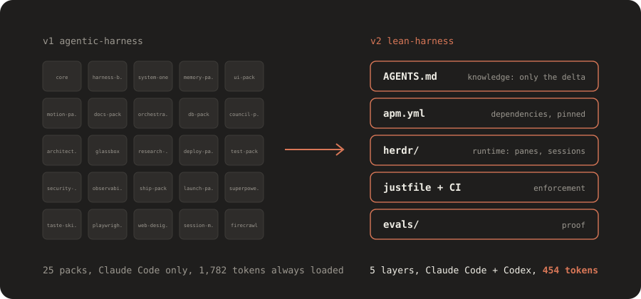

<div align="center">

<picture>
  <source media="(prefers-color-scheme: dark)" srcset="docs/assets/hero-dark.svg">
  <source media="(prefers-color-scheme: light)" srcset="docs/assets/hero-light.svg">
  
</picture>

<br>

### A lean, agent-agnostic harness. Only what the model does not already know.

[](https://github.com/Parthkomalwad/lean-harness/actions/workflows/check.yml)
[](LICENSE)
[](https://microsoft.github.io/apm/)
[](#old-vs-new)

[Install](#install) · [Old vs new](#old-vs-new) · [Evals](#eval-results) · [Why lean](docs/adr/0001-why-lean.md) · [Migration](docs/migration.md)

</div>

<br>

## Where this came from

[agentic-harness](https://github.com/Parthkomalwad/agentic-harness) was v1: 25 packs of skills, agents and hooks for Claude Code, each off until needed. It taught me what a harness is for. It also taught me that current models already know most of what those packs said, and that a harness locked to one agent is hard to keep.

lean-harness is v2. It keeps only the delta, and moves everything else to the layer where it belongs.

## Old vs new

| Layer | agentic-harness (v1) | lean-harness (v2) |
|---|---|---|
| Knowledge | 25 packs of skills | `AGENTS.md` with only the delta, in ASD-STE-100 |
| Dependencies | Upstream packs in my marketplace | Pinned in `apm.yml`, installed by [Microsoft APM](https://microsoft.github.io/apm/) |
| Runtime | Orchestrator and memory skills | [Herdr](https://herdr.dev/docs/) panes, plain files for memory |
| Enforcement | Claude Code hooks | Scripts, git hooks and CI |
| Proof | None | An eval suite that measures each piece |
| Agents | Claude Code only | Claude Code and Codex |

Always-loaded text, measured by `just budget`: **1,782 tokens** in v1 with all packs on, **454 tokens** in v2.

## Install

Pick the way that fits you.

### 1. Add it to your project (any agent)

Install [APM](https://microsoft.github.io/apm/getting-started/installation/) once:

```sh
curl -sSL https://aka.ms/apm-unix | sh      # Linux and macOS
irm https://aka.ms/apm-windows | iex        # Windows PowerShell
```

Then, in your project:

```sh
apm install Parthkomalwad/lean-harness#v0.2.0
```

This deploys the `ui-taste` skill and the four pinned upstream skills to Claude Code, Codex or any other [APM target](https://microsoft.github.io/apm/reference/targets-matrix/). For the rules, copy [`AGENTS.md`](AGENTS.md) into your project and edit it. Add a `CLAUDE.md` with one line: `@AGENTS.md`.

### 2. Only the UI skill, as a Claude Code plugin

```text
/plugin marketplace add Parthkomalwad/lean-harness
/plugin install ui-taste@lean-harness
```

### 3. Use it in every project on your machine

Clone the repo, then load its `AGENTS.md` from your user-level `~/.claude/CLAUDE.md`. The steps for Windows, Linux and macOS are in [docs/extending.md](docs/extending.md#use-it-in-every-project-claude-code).

### 4. Fork it and make it yours

You need APM, [just](https://github.com/casey/just) and Node.js 20 or later. [Herdr](https://herdr.dev/docs/install/) is optional.

```sh
git clone https://github.com/<your-name>/lean-harness
cd lean-harness
apm install      # deploys skills to .claude/ and .agents/
just setup       # turns on the git hooks
just test
```

Edit `AGENTS.md` with your own rules. To add skills, plugins or MCP servers, see [docs/extending.md](docs/extending.md).

### Open it in Herdr

```sh
just herdr
```

This starts Claude Code and Codex side by side in one Herdr workspace. Run `herdr` to attach. See [herdr/README.md](herdr/README.md) for the multi-agent council.

## What is in it

| Path | Job |
|---|---|
| [`AGENTS.md`](AGENTS.md) | My preferences for writing, git, code and tests. Every agent reads it. |
| [`CLAUDE.md`](CLAUDE.md) | One line that imports `AGENTS.md`. |
| [`apm.yml`](apm.yml) | Upstream skills, pinned to a commit. |
| [`.apm/skills/ui-taste`](.apm/skills/ui-taste/SKILL.md) | The one local skill: my UI rules. |
| [`justfile`](justfile) | `deploy`, `test`, `release`, `eval`, `budget`, `herdr`. |
| [`scripts/`](scripts/) | The code behind the recipes: token budget, STE lint, eval runner, release notes. |
| [`.githooks/`](.githooks/) | Pre-commit checks. `global/commit-msg` blocks AI attribution and em dashes in any repo. |
| [`herdr/`](herdr/) | Scripts that open agents side by side and run the council. |
| [`evals/`](evals/) | 20 tasks, run with and without each piece. |
| [`docs/adr/`](docs/adr/) | Decisions. Memory that any agent can read. |
| [`docs/extending.md`](docs/extending.md) | How to add skills, plugins, MCP servers and rules. |

### Upstream skills

`apm install` also brings in these skills, each pinned to one commit. Credit goes to their authors.

| Skill | Source | Use |
|---|---|---|
| superpowers | [obra/superpowers](https://github.com/obra/superpowers) | Planning, TDD, debugging and review workflows |
| taste-skill | [Leonxlnx/taste-skill](https://github.com/Leonxlnx/taste-skill) | Art direction for web pages |
| playwright-cli | [microsoft/playwright-cli](https://github.com/microsoft/playwright-cli) | Browser automation and screenshots |
| web-design-guidelines | [vercel-labs/agent-skills](https://github.com/vercel-labs/agent-skills) | UI review against web interface guidelines |

## Supported agents

APM deploys to the targets in `apm.yml`: `claude` (Claude Code) and `codex` (Codex). APM supports more targets, for example `copilot`, `gemini`, `opencode`, `windsurf` and `kiro`. See the [APM targets matrix](https://microsoft.github.io/apm/reference/targets-matrix/). The `cursor` target is off for now: the superpowers hooks clash with it. [ADR-0001](docs/adr/0001-why-lean.md) has the details.

The eval results below are for Claude Code. APM deploys the same files for Codex, but the Codex eval has not run yet. Run `just eval codex` to add it.

## Eval results

`just eval` runs each task in a clean folder twice: with the piece under test, and without it. A task passes when the output matches its checks.

<!-- eval:start -->
Claude Code, 3 runs per task, 2026-10-23:

| Piece | With | Without | Gain |
|---|---|---|---|
| `AGENTS.md` | 45/45 (100%) | 39/45 (87%) | +13 points |
| `ui-taste` skill | 15/15 (100%) | 11/15 (73%) | +27 points |

What made the difference:

- Without `AGENTS.md`, the commit message got a `Co-Authored-By` trailer for the AI (3 of 3 runs).
- Without `AGENTS.md`, the agent did not know to run `just test` before it reported a task as complete (3 of 3).
- Without `ui-taste`, the page review missed the "too many competing actions" problem (3 of 3).
- Without `ui-taste`, one hero section used an emoji as an icon (1 of 3).

The model already did the rest without help: it kept `.env` out of the commit, skipped a needless abstraction, avoided a new dependency and fixed the bug in the shared function.

Each run uses an empty Claude Code config, so user-level rules and skills do not leak into the "without" runs.

Most tasks pass both ways. That is the point of this repo: a current model already does most things well, so the harness holds only the small delta. The 2026 [ETH Zurich study](https://arxiv.org/abs/2602.11988) found the same: context files help most when they hold non-standard practices.
<!-- eval:end -->

Full table: [evals/results/claude.md](evals/results/claude.md).

## Read more

- [ADR-0001: why lean](docs/adr/0001-why-lean.md)
- [Migration: what happened to each v1 pack](docs/migration.md)
- [Writing style: ASD-STE-100](docs/style-ste.md)
- [Extending: add skills, plugins and MCP servers](docs/extending.md)
- [Evaluating AGENTS.md](https://arxiv.org/abs/2602.11988) (ETH Zurich, 2026): context files help most when they hold non-standard practices. This repo applies that finding.

## Contributing

Issues and pull requests are welcome. A new skill or rule needs an eval task that shows a gain. See [docs/extending.md](docs/extending.md#contribute-back).

## Security

- Upstream skills and hooks run on your machine. Read them before you install.
- APM pins each dependency to a commit. `apm audit` scans every install for hidden Unicode and drift, and CI runs it on each push.

## Notes

- Not affiliated with or endorsed by Anthropic, Microsoft or OpenAI.
- [MIT](LICENSE). Upstream skills keep their own licenses.
